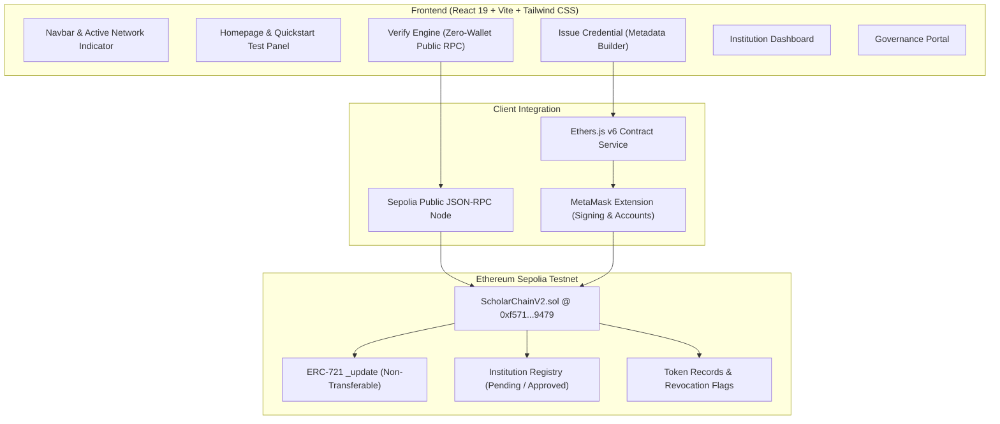

# ScholarChain — Internship Review & Live Demonstration Guide

**Project:** ScholarChain (Decentralized Academic Credential Management & Public Verification)  
**Organization:** Nexus Scholars  
**Target Baseline:** `codex/v2-scholar-chain`  
**Active Working Branch:** `feat/review-demo-polish`  
**Date:** October 2026  

---

## 1. Executive Summary & Purpose

ScholarChain is a decentralized academic credential verification system developed for college and enterprise evaluation. It solves the critical problem of credential fraud and unverified diploma factories by issuing **Soulbound Tokens (Non-Transferable ERC-721)** on the Ethereum Sepolia Testnet.

### Core Value Proposition
1. **Soulbound (Non-Transferable):** Overrides OpenZeppelin's `_update` logic to prevent credentials from being traded, sold, or moved between student wallets.
2. **Permissioned Institutional Issuance:** Only universities reviewed and approved by the Governance Administrator can mint credentials.
3. **Zero-Wallet Public Verification:** Employers, academic evaluators, and recruiters can verify any credential in seconds over public Sepolia RPC without installing MetaMask or paying cryptocurrency gas fees.
4. **On-Chain Revocation:** Institutions and governance admins retain the cryptographic capability to revoke erroneous records in real time.

---

## 2. Technical Stack Actually Implemented

| Layer | Technologies Used | Purpose |
|:---|:---|:---|
| **Smart Contracts** | Solidity `^0.8.20`, OpenZeppelin Contracts v5.0 | ERC-721 non-transferable token logic, role governance, and on-chain record registry. |
| **Blockchain** | Ethereum Sepolia Testnet (`chainId: 11155111`) | Contract deployed at `0xf5716dEbdEe3E5aADD1fB4975EA2dc65Ceb59479`. |
| **Frontend Framework**| React 19.2.6, Vite 8.0.12, Tailwind CSS 4.3.0 | Modern single-page web application with reactive state and routing. |
| **Web3 Client** | Ethers.js v6.16.0 | Contract communication, ABI encoding, and MetaMask JSON-RPC provider. |
| **Decentralized Storage** | RFC 2397 Base64 JSON Data URIs & IPFS Gateway | Autonomous on-chain metadata storage without third-party centralized server dependence. |
| **Quality & Build** | ESLint 10, Rolldown / Vite build runner | Strict code linting and production bundle minification. |

---

## 3. Architecture Overview



### Data Flow Breakdown
1. **Public Verification Workflow:** `VerifyCredential.jsx` calls `getV2Credential(tokenId)` in `ScholarChainV2Service.js`. Ethers connects via a public Sepolia JSON-RPC provider (no wallet required), executes `credentials(tokenId)`, and queries `institutionProfiles(issuer)`. If a metadata URI is linked, the browser parses the base64 JSON payload and renders the credential card with full verification badges.
2. **Issuance Workflow:** `IssueCredential.jsx` packages the student address, achievement title, dates, and citation into a standard JSON schema, base64-encodes it into a `data:application/json;base64,...` URI, and invokes `mintCredential(...)` via the signer contract. The institution wallet confirms the transaction on MetaMask and pays testnet gas.

---

## 4. Summary of Polished Improvements

1. **Academic Branding & Product Mark:**
   * Designed a bespoke ScholarChain logo mark with an academic mortarboard crest and blockchain chain nodes on dark navy and gold.
   * Updated `frontend/public/favicon.svg` and `index.html` with title `ScholarChain — Decentralized Academic Credentials & Verification`.
   * Preserved distinct identity between the **ScholarChain** product and the **Nexus Scholars** team.
2. **Reviewer Demo Quickstart Panel:**
   * Added an evaluation panel on the homepage with 1-click test triggers for live Sepolia Token #1, Token #2, and the Student Credential Vault.
3. **Public Navigation Enhancements:**
   * Prominently surfaced primary routes: **Home**, **Verify**, **Institution Portal**, and **Issue Credential**.
   * When accessed without an authorized wallet, operational pages provide helpful guidance cards with the exact demo institution wallet address (`0x74E2...794d`).
4. **Interactive Verification Demo Chips:**
   * Added quick-query chips on `/verify`:
     - `⚡ Token #1 (B.S. in CS - SC-2026-QHOE7)`
     - `⚡ Token #2 (Honors Credential - SC-2026-W4JXO)`
     - `⚡ Student Vault (0x8D66...cD6A)`
5. **Decoupled Form Preview & Educational Notes:**
   * In `IssueCredential.jsx`, visitors can test form validation, auto-ID generation, and JSON metadata generation in demonstration mode before signing.
   * Educational sidebars explain Soulbound immutability, Sepolia gas, and role boundaries.
6. **Comprehensive Academic Footer:**
   * Integrated a full footer displaying the active contract address with an Etherscan link, technology stack badges, and the 6 Nexus Scholars contributors.

---

## 5. Files Modified on `feat/review-demo-polish`

* [`frontend/index.html`](file:///home/aetheon-star/projects/scholar-chain/frontend/index.html): Updated title and meta description.
* [`frontend/public/favicon.svg`](file:///home/aetheon-star/projects/scholar-chain/frontend/public/favicon.svg): Bespoke SVG product mark.
* [`frontend/src/components/ScholarChainLogo.jsx`](file:///home/aetheon-star/projects/scholar-chain/frontend/src/components/ScholarChainLogo.jsx): Reusable SVG logo and brand header component.
* [`frontend/src/components/Navbar.jsx`](file:///home/aetheon-star/projects/scholar-chain/frontend/src/components/Navbar.jsx): Universal navigation to Home, Verify, Institution Portal, Issue Credential.
* [`frontend/src/components/WalletConnect.jsx`](file:///home/aetheon-star/projects/scholar-chain/frontend/src/components/WalletConnect.jsx): Network indicator and role tooltip.
* [`frontend/src/components/Footer.jsx`](file:///home/aetheon-star/projects/scholar-chain/frontend/src/components/Footer.jsx): Full academic footer with contract details and team attributions.
* [`frontend/src/App.jsx`](file:///home/aetheon-star/projects/scholar-chain/frontend/src/App.jsx): Integrated footer and ambient styling.
* [`frontend/src/pages/Home.jsx`](file:///home/aetheon-star/projects/scholar-chain/frontend/src/pages/Home.jsx): Added demo quickstart panel, blockchain architecture cards, and role permissions matrix.
* [`frontend/src/pages/VerifyCredential.jsx`](file:///home/aetheon-star/projects/scholar-chain/frontend/src/pages/VerifyCredential.jsx): 1-click live demo query chips, public RPC explanation, and error handling.
* [`frontend/src/pages/IssueCredential.jsx`](file:///home/aetheon-star/projects/scholar-chain/frontend/src/pages/IssueCredential.jsx): Form preview mode, plain-language guidance, and metadata builder inspection.
* [`frontend/src/pages/AdminDashboard.jsx`](file:///home/aetheon-star/projects/scholar-chain/frontend/src/pages/AdminDashboard.jsx): Reviewer demo guidance for the institution portal.
* [`frontend/src/pages/IssuerApplication.jsx`](file:///home/aetheon-star/projects/scholar-chain/frontend/src/pages/IssuerApplication.jsx): Replaced raw anchors with SPA `<Link>` navigation.

---

## 6. How to Run Locally

```bash
# 1. Navigate to frontend directory
cd /home/aetheon-star/projects/scholar-chain/frontend

# 2. Run ESLint verification
npm run lint

# 3. Compile production build
npm run build

# 4. Start local development server
npm run dev
```

Application runs locally at: `http://localhost:5173/`

---

## 7. Build & Verification Evidence

* **Lint Check (`npm run lint`):** `0 errors`, `0 warnings` (ESLint 10 passed).
* **Production Build (`npm run build`):** Built client production bundle cleanly in `2.77s` (`dist/assets/index-Bsz6o-3x.js` ~189 kB gzipped).
* **Vite Dev Server:** Active on `http://localhost:5173/` with hot module replacement (HMR).

---

## 8. Verified Test Results Matrix

| Scenario ID | Test Description | Execution Method | Result | Notes / Evidence |
|:---:|:---|:---:|:---:|:---|
| **T-01** | Public Verification of valid Token ID (Token #1) | Node / Sepolia RPC | **PASS** | Successfully retrieved `SC-2026-QHOE7`, decoded Base64 metadata, verified `revoked: false`. |
| **T-02** | Public Verification of valid Token ID (Token #2) | Node / Sepolia RPC | **PASS** | Retrieved `SC-2026-W4JXO` for student `0x8D66...cD6A`. |
| **T-03** | Public Lookup of Student Wallet Portfolio | Node / Sepolia RPC | **PASS** | Returned 2 verified credentials for `0x8D665e3D77bcA5141E04a2E0324E53b9Cb91cD6A`. |
| **T-04** | Nonexistent Token ID Query (e.g., Token #99999) | Node / Sepolia RPC | **PASS** | Contract error cleanly decoded: *"Credential does not exist. Check that the Token ID was minted."* |
| **T-05** | Malformed Wallet Address Validation | Client Regex / Source | **PASS** | Blocked with message: *"Please enter a valid 42-character Ethereum wallet address."* |
| **T-06** | IPFS Gateway Failure Fallback | Node / Source | **PASS** | `fetchV2Metadata` handles gateway timeout gracefully and returns `null` without crashing. |
| **T-07** | Institution Status Resolution (Approved) | Node / Sepolia RPC | **PASS** | Address `0x74E2...794d` returns `status: 2 (APPROVED)`. |
| **T-08** | Institution Status Resolution (Unregistered) | Node / Sepolia RPC | **PASS** | Random address returns `status: 0 (NONE)`. |
| **T-09** | Contract Owner Verification | Node / Sepolia RPC | **PASS** | `getV2Owner()` confirmed as `0x52dEc6d91876e874E20b8DA50ea93FADEB277a3c`. |
| **T-10** | Unsupported Network Switch Detection | Static / Client | **PASS** | Top banner displays warning and provides 1-click `switchToSepoliaNetwork()`. |
| **T-11** | Interactive MetaMask Extension Popup & Signing | Headless Browser | **BLOCKED** | Browser extension popup cannot be clicked in headless environment. Requires desktop browser. |

---

## 9. 3-to-5 Minute Demonstration Script

Use this exact sequence during your review demonstration:

### Minute 1: Introduction & Homepage Overview (Route: `/`)
* **What to say:** *"Good morning panel. Today we present ScholarChain, an Ethereum-based academic credential tokenization and public verification platform developed by Nexus Scholars."*
* **What to show:**
  * Point out the academic branding, the **V2 Sepolia** badge, and the contract target address in the footer.
  * Explain the 3 roles: **Governance Admin**, **Approved University**, and **Student Recipient**.
  * Highlight the core principle: Credentials are **Soulbound Tokens**—they cannot be transferred or sold once issued.

### Minute 2: Public Verification without a Wallet (Route: `/verify`)
* **What to say:** *"One of ScholarChain's most important capabilities is zero-wallet public verification. Employers and verifiers do not need MetaMask or cryptocurrency to verify a degree."*
* **What to show:**
  * Click the **Verify** link in the navbar.
  * Click the demo shortcut chip: **🎓 Token #1 (B.S. in CS)**.
  * Click **Verify Token**. In less than two seconds, the live on-chain record loads directly from Ethereum Sepolia.
  * Click on the verified card to open the **Credential Details Modal**.
  * Highlight:
    * The on-chain **Status: Valid / Non-Revoked**.
    * The **Issuing University**: ScholarChain Test University (`0x74E2...794d`).
    * The **Recipient Wallet**: `0x8D66...cD6A`.
    * Click **Raw Metadata URI** to show the decentralized base64 JSON payload.

### Minute 3: Student Portfolio Vault (Route: `/verify`)
* **What to say:** *"Employers can also audit an applicant's complete credential history by pasting the student's public wallet address."*
* **What to show:**
  * Switch to the **Lookup Student Portfolio** tab.
  * Click **📂 Student Vault (0x8D66...cD6A)** and click **View Student Vault**.
  * Show that the smart contract returns both Token #1 and Token #2 issued to this student.

### Minute 4: Institution Issuance & Metadata Builder (Route: `/issue`)
* **What to say:** *"Now let's examine the institutional issuance workflow. Minting is strictly permissioned on-chain."*
* **What to show:**
  * Click **Issue Credential** in the navbar.
  * Point out the **Issuing Authority** status card and explain how role gating works.
  * Click **Autofill Demo Values** under the Demo Quick-Fill preset.
  * Click **Preview JSON Payload** under the Decentralized Metadata Builder.
  * Explain: *"The application generates standard EIP-721 metadata on the fly. When signed by an approved university wallet, this data is committed to the Sepolia ledger."*

### Minute 5: Governance, Security & Limitations (Route: `/`)
* **What to say:** *"To prevent credential fraud, ScholarChain implements on-chain governance. Only approved universities can mint. If an institution makes an error or a student is disqualified, the contract provides real-time revocation."*
* **What to show:**
  * Scroll to the **Permission Matrix & Demo Accounts** section on the homepage.
  * State the project limitations honestly:
    - Current prototype uses base64 data URIs alongside IPFS.
    - Testnet environment (Sepolia) rather than mainnet to eliminate gas costs during evaluation.
  * Conclude: *"Thank you. We are happy to take questions."*

### Emergency Fallback Plan (If Testnet or WiFi Fails)
1. If Sepolia JSON-RPC is slow or throttled:
   * Explain that public RPC endpoints have rate limits.
   * Use the offline screenshots in `frontend/dist/*.png` or show the pre-computed test results in Section 8.
2. If MetaMask extension fails to open:
   * Demonstrate the public verification flow on `/verify` (which requires zero wallet interaction).

---

## 10. Remaining Prototype Limitations & Future Roadmap

1. **Decentralized Storage:** The current prototype defaults to base64 Data URIs directly in contract storage (which is 100% resilient and requires no external servers). A future production deployment would integrate a permanent decentralized IPFS pinning cluster (e.g., Filecoin or Arweave).
2. **Automated End-to-End Tests:** Currently covered by manual test matrices ([`QA_TEST_MATRIX.md`](file:///home/aetheon-star/projects/scholar-chain/docs/QA_TEST_MATRIX.md) and [`WALLET_STATE_TEST_MATRIX.md`](file:///home/aetheon-star/projects/scholar-chain/docs/WALLET_STATE_TEST_MATRIX.md)). Introducing Vitest and Hardhat for automated unit testing is planned for the next release.
3. **Multi-Signature Governance:** Governance admin controls are currently single-owner (`0x52dE...7a3c`). Production systems should implement a Gnosis Safe multi-signature contract.
